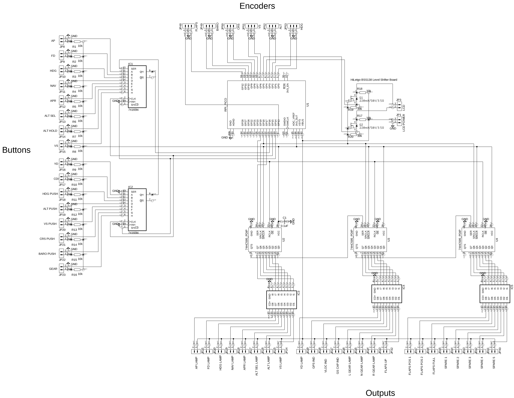
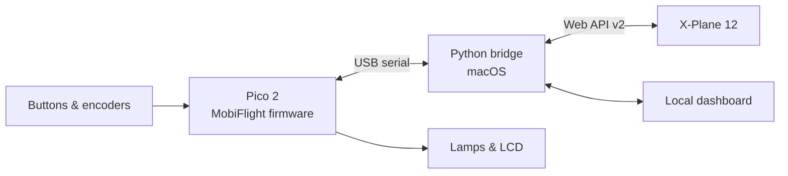

# ap-panel

**A physical autopilot and IFR control panel for X-Plane, built around a Raspberry Pi Pico 2.**

Rotary encoders, mode buttons, annunciator lamps, and a 20 × 4 LCD bring the simulator's autopilot controls onto the desk. A Python bridge on macOS connects the panel to X-Plane and provides a local diagnostics dashboard.

> **Work in progress** — this repository documents an active breadboard build and its software. Wiring, aircraft profiles, and setup procedures are still being verified. It is being shared during development, rather than as a finished kit or stable release.

[The build](#the-build) · [How it works](#how-it-works) · [Try the demo](#try-the-demo) · [Documentation](#documentation)

[](ap-panel-schematic-breadboard.png)

*Current breadboard schematic — click the image for the full-resolution drawing. The drawing is a prototype reference; see the [hardware notes](#hardware-notes) before following its wiring.*

## The build

The aim is a compact panel for heading, altitude, vertical speed, course, barometer, flaps, and autopilot modes, with feedback that follows the simulator.

| Part | Current design |
|---|---|
| Controller | One Raspberry Pi Pico 2 |
| Rotary controls | Six encoders: HDG, ALT, VS, CRS, BARO, and FLAPS |
| Discrete inputs | Ten buttons, five encoder pushes, and a gear toggle |
| Annunciators | 19 assigned lamps, with five spare output channels |
| Display | 20 × 4 character I²C LCD |
| Input expansion | Two 74HC165 shift registers |
| Output expansion | Three 74HC595 shift registers and three ULN2803 drivers |
| Firmware | Stock MobiFlight 3.1.4 |
| Host software | Python 3.12+ with a local browser dashboard |
| Initial aircraft targets | Laminar's analog C172 and King Air C90B |

The hardware assignments live in [`electronics/pinmap.yaml`](electronics/pinmap.yaml). The [generated pinout](electronics/pinout.md) includes GPIOs, connectors, and the complete input/output mapping.

## How it works



Physical controls request changes in X-Plane. The bridge reads simulator feedback to drive the lamps and LCD, so cockpit changes can also appear on the panel.

The Pico runs MobiFlight firmware; the bridge and dashboard run on the Mac. The design uses X-Plane's built-in Web API v2, targeting X-Plane 12.1.4 or newer.

## Current status

The repository contains the breadboard schematic, pin map, serial and simulator transports, aircraft profile candidates, dashboard, bench tools, and automated tests.

Bring-up and integration are ongoing:

- The C172 and C90B profiles still need testing against the installed aircraft.
- Encoder decoding, LCD address, gear indices, and flap positions need physical measurement.
- Yaw-damper engagement feedback needs verification before its lamp is enabled.
- End-to-end hardware, recovery, and endurance checks remain part of commissioning.

The default configuration keeps hardware and aircraft verification flags unset. Normal Start checks those flags; the development workflow provides separate bench, observe, and commissioning modes. See the [commissioning checklist](documentation/commissioning.md) and [verification record](documentation/verification.md) for the details.

## Try the demo

The existing offline demo uses sample telemetry to explore the dashboard during development. A Pico and X-Plane are not needed for this mode.

Install [uv](https://docs.astral.sh/uv/getting-started/installation/), clone the repository, then run:

```bash
git clone https://github.com/cpstrommen/ap-panel.git
cd ap-panel
uv sync --no-editable
uv run --no-editable ap-panel run --demo
```

The dashboard defaults to **http://127.0.0.1:8787**. Stop the terminal process with **Ctrl-C**; Ctrl-Z suspends it and leaves its port occupied.

Keep `--no-editable` on uv commands to avoid the macOS editable-install path issue described in [troubleshooting](documentation/troubleshooting.md#import-fails-after-a-successful-launch). Source, profile, calibration, and dashboard changes are included in uv's rebuild cache keys.

## Hardware notes

The 74HC595-to-ULN2803 connections are reversed to suit the breadboard arrangement: Q0 connects to ULN input 8, through to Q7 connecting to input 1. The lamp connections follow that arrangement, preserving the logical output order. A HIGH shift-register output lights its assigned lamp.

The schematic also has an input/pull-up topology that needs checking against the actual breadboard. Each 74HC165 input should share a node with its pull-up resistor and switch signal contact; the other switch contact goes to ground. The drawing's `74165N` and `RPI_PICO` symbols do not establish the physical part variants.

The [hardware reference](documentation/technical-reference.md#breadboard-pin-map) and [commissioning guide](documentation/commissioning.md) retain the detailed wiring notes and checks.

## Documentation

| Guide | Contents |
|---|---|
| [Hardware and software reference](documentation/technical-reference.md) | Full pin maps, reversed driver wiring, aircraft behavior, firmware installation, CLI workflow, serial protocol, and known limits |
| [Commissioning](documentation/commissioning.md) | Physical input/output checks, calibration, aircraft testing, and qualification records |
| [Troubleshooting](documentation/troubleshooting.md) | Installation, USB, display, simulator, and recovery issues |
| [Verification record](documentation/verification.md) | Historical software checks and remaining hardware acceptance work |
| [Contributing](CONTRIBUTING.md) | Reporting findings and making focused changes |
| [Third-party notices](THIRD_PARTY_NOTICES.md) | Upstream projects and integration references |

## Repository map

```text
electronics/     Canonical pin map and generated pinout
mobiflight/      Firmware provenance and generated device records
profiles/        Aircraft mappings and calibration
src/ap_panel/    Python bridge, transports, rendering, and CLI
web/            Local dashboard assets
tests/          Protocol, runtime, profile, and installation checks
documentation/  Technical reference, commissioning, and troubleshooting
```

To work on the software:

```bash
uv run --no-editable pytest
uv run --no-editable ruff check src tests
```

Most tests use simulated endpoints. The installed-package regression uses uv's offline mode and requires cached build/runtime dependencies. Historical test results are recorded in the [verification guide](documentation/verification.md); they do not establish that the physical panel or aircraft integration is finished.

## Contributing

Wiring observations, aircraft behavior reports, documentation improvements, and focused software changes are welcome. Please include the relevant hardware/aircraft versions and redact local settings or personal data from diagnostics. See [CONTRIBUTING.md](CONTRIBUTING.md).

## License and acknowledgments

Original project code and documentation are available under the [MIT license](LICENSE). MobiFlight firmware is downloaded separately, and upstream projects retain their own licenses; see [third-party notices](THIRD_PARTY_NOTICES.md).

Built around [MobiFlight](https://github.com/MobiFlight/MobiFlight-FirmwareSource), [Raspberry Pi Pico](https://www.raspberrypi.com/products/raspberry-pi-pico-2/), and [X-Plane's Web API](https://developer.x-plane.com/article/x-plane-web-api/). This is an independent hobby project.
